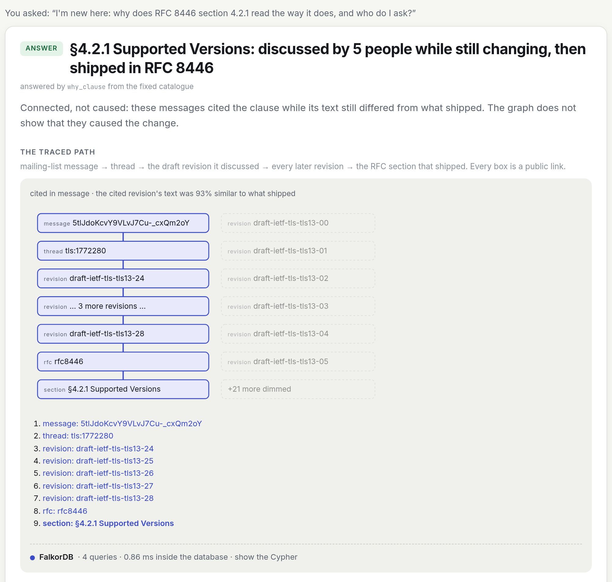
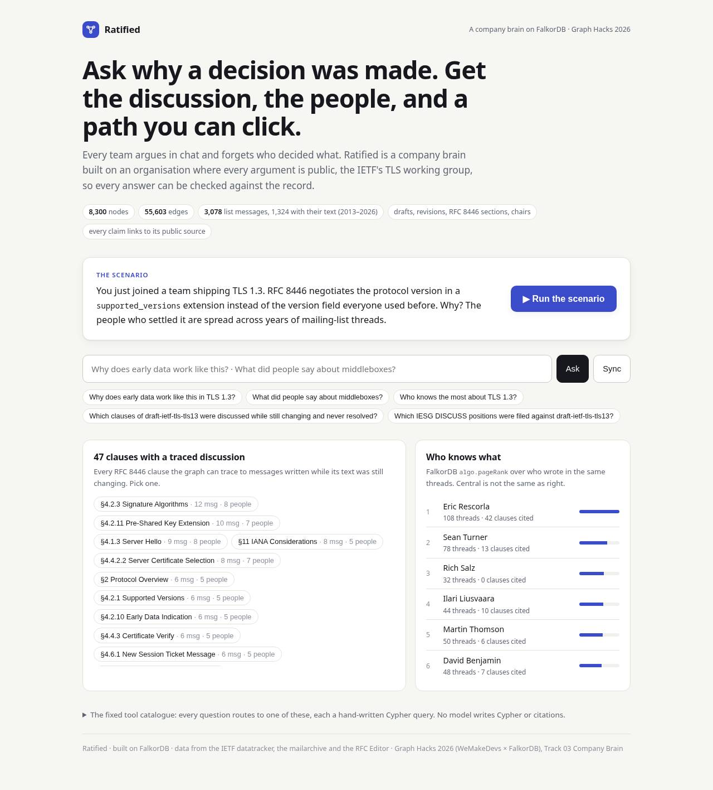

# Ratified

**Ask why a decision was made, and get the dated discussion behind it, the people who were there, and who to ask now. Every answer is a FalkorDB graph traversal that ends in a public link, and every answer card shows the Cypher that produced it.**

Every team argues in chat and forgets who decided what. Ratified is a company brain built on an organisation where every argument is public, the IETF's TLS working group, so a judge can click any answer through to the original email.

Graph Hacks 2026 (WeMakeDevs × FalkorDB) · **Track 03: Company Brain** · Live demo: _link added at deploy_ · Demo video: _link added before submission_



## The scenario (one click on the live page)

You just joined a team shipping TLS 1.3. RFC 8446 negotiates the protocol version in a `supported_versions` extension instead of the version field every earlier TLS used. Why? The people who settled it are spread across years of mailing-list threads.

Ask *"I'm new here: why does RFC 8446 section 4.2.1 read the way it does, and who do I ask?"* and the graph returns:

1. **The discussion.** 6 messages from 5 people in the thread *"draft-ietf-tls-tls13-24 supported_versions complexity"* (1–3 March 2018) cited §4.2.1 while draft -24 was current, and §4.2.1's text in -24 still differed from what shipped.
2. **The traced path.** message → thread → draft-ietf-tls-tls13-24 → -25 → -26 → -27 → -28 → RFC 8446 → §4.2.1. Every node is a link to the mail archive, the datatracker or the RFC Editor.
3. **What to read with it.** Clauses cited in the same messages: §4.1.3 Server Hello (6 shared messages), §4.1.2 Client Hello and §4.1.4 Hello Retry Request (2 each).
4. **Who to ask now.** The 5 people who cited it, plus the current TLS chairs and area directors, by name from the datatracker.
5. **A drafted question** to them, citing the thread and the section. It is rendered and **never sent**.
6. **The proof.** A panel listing the 4 Cypher queries FalkorDB ran for the card (under 1 ms inside the database).

You don't need a section number. *"Why does early data work like this in TLS 1.3?"* resolves to §4.2.10 Early Data Indication through FalkorDB's full-text index on section headings. The card says which words matched and offers the runner-up clauses as one-click alternatives. *"What did people say about middleboxes?"* returns quotes from the list. *"Who knows the most about TLS 1.3?"* ranks people with FalkorDB's PageRank. Ask about IESG ballots or meeting minutes, which were never ingested, and the card says **the graph does not know**.



## What the graph holds

One FalkorDB graph for one working group, rebuilt from the committed public record in one command:

| | Count | Source |
|---|---:|---|
| Mailing-list messages | 3,078 (2013–2026), **1,324 with their full text** | mailarchive.ietf.org browse and search pages, message downloads |
| Threads / people | 633 / 403 | the same |
| Drafts / draft revisions | 113 / 839 | datatracker API |
| RFCs a draft became | 66 | datatracker `became_rfc` relations |
| RFC 8446 sections | 84 | rfc-editor.org text |
| Chairs / area directors | 3 / 2 | datatracker roles and person records |
| **Total** | **8,300 nodes · 55,603 edges** | |

The TLS 1.3 design era is covered by one archive search per draft revision, -18 to -28, with every message body downloaded (0 failures). That gives 333 `CITES` edges and **47 RFC 8446 clauses** that can be traced to a discussion.

### Graph data model

```
(Person)-[:AUTHORED]->(Message)-[:IN_THREAD]->(Thread)
(Message)-[:HAS_BODY]->(MessageBody {text})
(Message)-[:DISCUSSED]->(DraftRevision)          the message names the revision, e.g. "draft-ietf-tls-tls13-24"
(Message)-[:CITES]->(Section)                    "Section 4.2.1" in the message, resolved through that revision's alignment
(Thread)-[:ABOUT_SECTION {matched_tokens}]->(Section)   subject-word overlap: a labelled lead, not evidence
(Draft)-[:HAS_REVISION]->(DraftRevision)-[:SUPERSEDED]->(DraftRevision)
(DraftRevision)-[:BECAME]->(RFC {published})-[:HAS_SECTION]->(Section)
(DraftRevision)-[:ALIGNS_SECTION {similarity, changed, how}]->(Section)
(Draft)-[:IN_WG]->(Wg)<-[:CHAIRS]-(Chair)    (Wg)<-[:AD_FOR]-(AreaDirector)

derived in FalkorDB by Cypher at ingest:
(Section)-[:CO_CITED {n}]->(Section)             two sections cited by the same message (n messages)
(Person)-[:CO_DISCUSSED {n}]->(Person)           two people who wrote in the same thread (n threads)

full-text indexes: Section.title · Message.subject · MessageBody.text
```

| Node | Key properties |
|---|---|
| `Message` | `id` (mailarchive id), `subject`, `date`, `from`, `url`, `has_body` |
| `Thread` | `id` (`tls:<n>`), `subject`, `url`, `n_messages`, `first_date`, `last_date` |
| `DraftRevision` | `id` (`draft-ietf-tls-tls13-24`), `rev`, `date` |
| `RFC` | `id` (`rfc8446`), `number`, `title`, `url`, `published` (month, read from the RFC header) |
| `Section` | `id` (`rfc8446#4.2.1`), `number`, `title`, `url` (rfc-editor anchor) |
| `Person`, `Chair`, `AreaDirector` | `name`, `email` |

The schema (version 2) lives in [`src/ratified/schema.py`](src/ratified/schema.py), and ingest and every query build their statements from it. Four edges carry the reasoning:

* **`ALIGNS_SECTION`** maps each section of each draft revision to the RFC section it became. It matches **by heading text, not by number**, because numbers shift between revisions. `changed` is true when that revision's section text is less than 98% similar to the shipped text.
* **`DISCUSSED`** links a message to every draft revision it names.
* **`CITES`** links a message to an RFC section, but only through a revision the same message names. "Section 4.2.9" in a message about -21 means *-21's* §4.2.9, which the alignment resolves to RFC §4.2.10. A citation that can't be resolved is dropped, not guessed.
* **`CO_CITED` and `CO_DISCUSSED`** are projections FalkorDB computes from the record. They're written in both directions because PageRank follows edge direction and a pair of people has none.

### What FalkorDB does, query by query

All Cypher is hand-written in [`src/ratified/tools.py`](src/ratified/tools.py), [`search.py`](src/ratified/search.py) and [`insights.py`](src/ratified/insights.py). A deterministic router ([`routing.py`](src/ratified/routing.py)) sends each question to **one tool from a fixed catalogue**. No model writes Cypher, and no model output becomes a citation. Every card's FalkorDB panel shows the queries that ran, their parameters, row counts and FalkorDB's own execution time.

**Resolve a clause named in plain words** (FalkorDB full-text index, terms OR-ed, scoped to the RFC the draft became):

```cypher
CALL db.idx.fulltext.queryNodes('Section', $q) YIELD node, score
MATCH (:Draft {id:$draft})-[:HAS_REVISION]->(:DraftRevision)-[:BECAME]->(:RFC)-[:HAS_SECTION]->(node)
RETURN DISTINCT node.id AS sid, node.number AS number, node.title AS title, node.url AS url, score
ORDER BY score DESC, number LIMIT $limit
```

**The discussion behind a clause**, counting a message only if it was written while the revision it names was current (before the next revision, or before the RFC's publication month for the last one):

```cypher
MATCH (s:Section {id:$sid})
MATCH (m:Message)-[:CITES]->(s)
MATCH (m)-[:DISCUSSED]->(dr:DraftRevision)-[al:ALIGNS_SECTION]->(s)
WHERE al.changed = true
OPTIONAL MATCH (dr)-[:SUPERSEDED]->(next:DraftRevision)
OPTIONAL MATCH (shipped:RFC)-[:HAS_SECTION]->(s)
WITH s, m, dr, coalesce(next.date, shipped.published + '-31') AS until
WHERE until IS NULL OR m.date <= until
MATCH (m)-[:IN_THREAD]->(t:Thread)
OPTIONAL MATCH (p:Person)-[:AUTHORED]->(m)
RETURN m.id AS mid, m.url AS murl, m.date AS date, m.subject AS subject,
       coalesce(p.name, m.from) AS person, t.id AS tid, t.url AS turl, t.subject AS tsubject,
       collect(DISTINCT dr.id) AS revisions
ORDER BY date, mid
```

**The traced path**, a variable-length walk down the revision chain to the section that shipped:

```cypher
MATCH p=(dr)-[:SUPERSEDED*0..]->(last:DraftRevision)
MATCH (last)-[:BECAME]->(rfc:RFC)-[:HAS_SECTION]->(s)
RETURN [n IN nodes(p) | n.id] AS chain, rfc.id AS rfc, s.number AS number
```

**Derived projections** (run at ingest, idempotent):

```cypher
MATCH (a:Section)<-[:CITES]-(m:Message)-[:CITES]->(b:Section) WHERE a.id <> b.id
WITH a, b, count(DISTINCT m) AS n
MERGE (a)-[r:CO_CITED]->(b) SET r.n = n

MATCH (p:Person)-[:AUTHORED]->(:Message)-[:IN_THREAD]->(t:Thread)<-[:IN_THREAD]-(:Message)<-[:AUTHORED]-(q:Person)
WHERE p.id <> q.id
WITH p, q, count(DISTINCT t) AS n
MERGE (p)-[r:CO_DISCUSSED]->(q) SET r.n = n
```

**Who knows what** (FalkorDB graph algorithms over the projection):

```cypher
CALL algo.pageRank('Person', 'CO_DISCUSSED') YIELD node, score
CALL algo.betweenness({nodeLabels:['Person'], relationshipTypes:['CO_DISCUSSED']}) YIELD node, score
```

**What people said**: `db.idx.fulltext.queryNodes` over `MessageBody.text` and `Message.subject`, then a traversal from each hit to its thread, its author and the clauses it `CITES`. The card quotes the writer's own words around the match, with quoted replies and email addresses removed.

Ingest is batched `UNWIND $rows AS r MERGE …` statements generated from the schema. Every card carries one of four outcomes: **answer**, **partial** (and which evidence is missing), **the graph does not know**, or **conflict** (the record disagrees with itself).

The catalogue: `why_clause`, `search_discussion`, `who_knows`, `aggregate_unresolved`, `who_argued`, `what_happened_to`, `precedent`, `sync`, `section_by_heading`, `revisions`, `count_unresolved`, `chairs`, `became_rfc`, `threads_by_subject`, `count_became`, `count_thread_messages`. `sync` re-fetches the last 24 hours of the list, adds the new messages and recomputes the projections.

## Evaluation

### Graph vs retrieval, 13 questions

Answer keys are derived from the primary record (the RFC Editor text, the datatracker API, the mailarchive pages) by [`bench/make_keys.py`](bench/make_keys.py). It is a second, independent parser that refuses to run if the product is imported, so no key comes from the graph it grades. [`bench/results.json`](bench/results.json) is the authoritative artefact.

| Questions | Graph (direct Cypher) | Graph via the shipped router | RAG baseline (BM25 + bge-small) |
|---|---|---|---|
| single-lookup | 4/4 | 4/4 | 1/4 exact, 3/4 in top-10 |
| collect | 3/3 | 3/3 | 0/3 |
| aggregate (counts) | 3/3 | 3/3 | not scoreable |
| unanswerable | 3/3 abstained | 3/3 abstained | 0/3 (no abstention) |

Read it carefully:

* **The fair comparison is the text-supported subset.** On the 3 questions whose evidence sits in text the retriever indexes (`a1`, `a2`, `b3`), it is **graph 3/3, RAG 1/3**. On the other scoreable questions the answer isn't in any text at all (revision lists are datatracker structure), so RAG's zeros there mostly measure the corpus. RAG's score rose as the corpus grew (1/10 → 3/10 in its top 10), and we report the higher number.
* **RAG can't abstain by construction.** It's a top-10 retriever with no score cutoff.
* **The router column was fitted to these 13 questions.** See the held-out sets below for an honest measure.
* **Small n, favourable domain.** 13 questions from the graph's own domain, reported as raw counts. `b1` and `c3` are one fact in two forms.

### The router on questions it never saw

Two sets of 40 questions were written by a second model (DeepSeek V4.1 Flash via Command Code) with no access to the router's code. Each set was scored once **before** any router change, and both results are committed.

| Set | First pass, before any change | Then |
|---|---|---|
| [`heldout`](bench/heldout_results.json) | 22/40 | used to generalise the router's vocabulary, so no longer held out |
| [`heldout2`](bench/heldout2_results.json) | **30/40 strict, 31/40 counting both kinds of correct decline** (the scorer printed 34/40; reading the rows showed 4 "any section" questions that took *TLS 1.3* as section 1.3, which is a wrong answer) | its misses were fixed ("TLS 1.3" is no longer read as a section number), so it is no longer held out either |

In the second set's first pass, 5 questions were confidently routed wrong. That's the number to keep in mind: a question phrased differently from anything above can still miss.

### Citation links, click-verified

[`bench/verify_chips.py`](bench/verify_chips.py) fetches a stratified sample of **10 of the 276** links the clause views render, applying the strictest check per kind (the RFC page must carry the `id="section-N"` anchor; the revision page must name the revision). 10/10 resolve on the current graph. An earlier run found **every revision link was a 404**, which was fixed. This is a sample, not the full set.

### Reproduce

```sh
docker compose up --build -d               # FalkorDB + the app; the app rebuilds the graph on boot
pip install -e '.[bench]'                  # rank_bm25 + fastembed + numpy, once
RATIFIED_FALKOR_PORT=16379 RATIFIED_OFFLINE=1 python -m ratified.bench
python bench/heldout.py heldout2           # the router on the second question set
```

Wait for `docker compose ps` to report the app healthy before running the bench. `RATIFIED_OFFLINE=1` makes the run network-free (the record is in `cache/http/`).

## Run it

```sh
git clone <this repo> && cd ratified
docker compose up --build        # FalkorDB + the app on http://127.0.0.1:8000, offline, no keys
```

The public record the graph is built from is committed (`data/`, `cache/http/`), so a fresh clone builds and runs with no network and no API key. To rebuild by hand (`pip install -e .`):

```sh
python -m ratified            # rebuild from the committed record, no network
python -m ratified --refresh  # re-fetch the datatracker and section text first, then rebuild
python -m ratified.mail --query draft-ietf-tls-tls13-24 --body-mode all   # pull one archive search with bodies
```

Tests: `RATIFIED_FALKOR_PORT=16379 pytest` (107 tests against the compose FalkorDB). Graph tests skip if no FalkorDB is reachable. Deployment scripts for a single EC2 host are in [`deploy/`](deploy/).

An LLM is optional and off in the demo (`RATIFIED_LLM=off`). When a provider key is set, it only breaks ties in the router and rephrases a card in one sentence, labelled *"LLM phrasing, not a source"*.

## Prior art

[mnot/ietf-llm](https://github.com/mnot/ietf-llm) builds a queryable corpus of an IETF working group's public record and summarises the positions argued on a topic. Ratified does not claim to be the first to mine working-group arguments. What it adds is a graph: answers are FalkorDB traversals ending in mechanical links (message → thread → revision → RFC section), "who knows what" and "read this with" come from graph projections and FalkorDB's algorithms, and an empty traversal is reported as "the graph does not know".

## Honest limits

**No causal claims.** The graph shows that an objection thread and a changed RFC clause are connected. It does not show that the objection caused the change.

* **"Discussed while still changing" is mechanical.** A message cited the clause, named a revision whose text for it was under 98% similar to the RFC, and was dated no later than that revision's successor (or the RFC's publication month). It does not mean the person objected; several people it names edited the draft. Message dates are day-precision, so a message from the same day as the next revision still counts.
* **Coverage.** 1,324 of 3,078 messages have their text. 1,753 of the 1,754 without it are 2026 list traffic, pulled from browse pages without bodies. 47 of RFC 8446's 84 sections have a traced discussion; the others are answered as *partial*, not filled in.
* **Plain-words resolution uses section headings only.** Adding section text to the index made broad overview sections outrank exact headings, so it was left out. In a hand spot-check of 10 topic questions, the first match was a sensible clause for 8. The two misses (*downgrade protection*, *middlebox compatibility*) matched one generic heading word. The card shows the matched words and the runner-ups for this reason.
* **People are merged by display name.** One person posts from several addresses, so 60 people were split before this rule. Two different people with the same name would now be merged. Mail-system "Last, First" names are turned round.
* **Centrality is not authority.** PageRank and betweenness rank how connected someone's conversations are, over every thread in the record, including 2026 traffic.
* **Clause communities were tried and dropped.** FalkorDB's label propagation put 47 of 57 co-cited clauses in one group, which tells a reader nothing. Direct co-citation counts are shown instead.
* **Subject-word leads are weak.** The `ABOUT_SECTION` links behind the aggregate card's "lead" bucket were hand-checked on an earlier, smaller set: **9 of 52** decided links correct (17.3%, 36 ties). They're labelled as leads and kept out of the headline count.
* **"No resolution trail"** means no later message in the record cites the clause. Decisions made in meetings, minutes or IESG ballots are outside the record.
* **The alignment** was precision-checked for draft-ietf-tls-tls13 -18 to -28 against RFC 8446 only.
* **The chairs and area directors are today's**, not the ones who chaired in 2018.

## AI use

AI coding assistants were used throughout. See [AI_USE.md](AI_USE.md) for what each one did and what a person verified.
